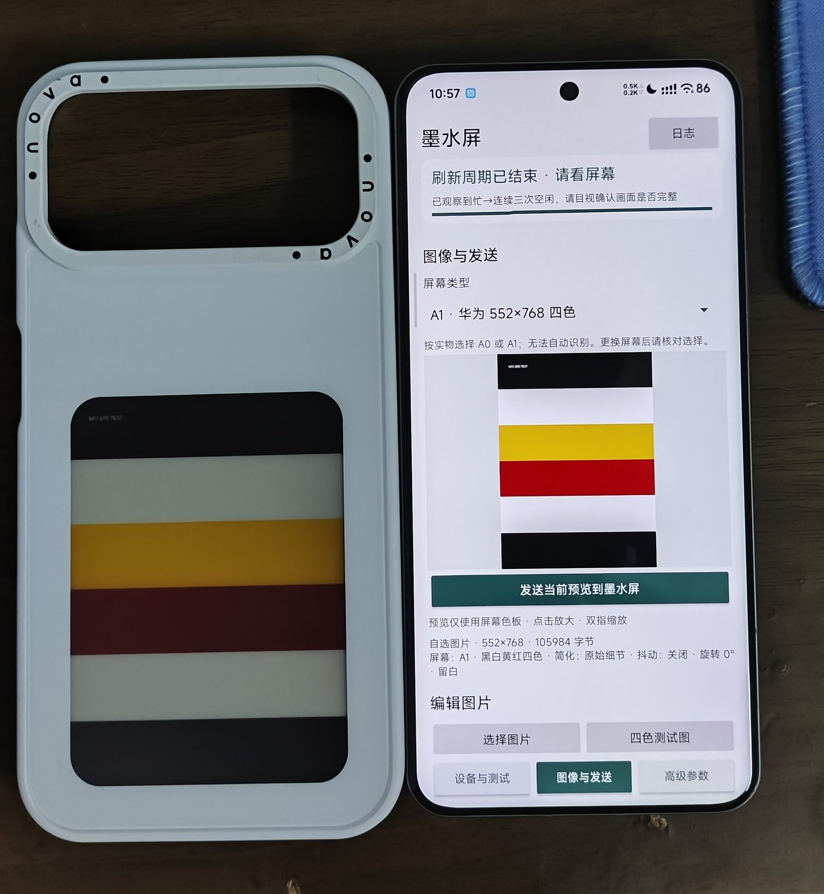

# nfc-15pro-st54l

在**小米 15 Pro（haotian / ST54L）** 上驱动 **华为 552×768 四色墨水屏手机壳** 的 KernelSU/Magisk 方案。

> 目标设备：Xiaomi 15 Pro（2410DPN6CC，Android 16，KernelSU）
> 结果：**已打通**——传图 476 包 + `DE` 刷新确认，壳子正常显示。



---

## 1. 为什么 15 Pro 原厂不行

壳子只响应 **7-bit 短帧 `0x7A`**（华为私有寻卡），普通 NFC 读卡器发的 `WUPA(0x52)` 它不理。
NXP 用 **Q-Poll**（NCI tech `0x71`）发这个短帧；ST 的方案是 **QTag + 自定义轮询帧**。

15 Pro 的 ST 栈缺了关键引擎：

| 文件 | 15 Pro 原厂 | 小米 17（pudding） |
| --- | --- | --- |
| `odm/lib64/nfc_nci.st21nfc.st.so` | 200,560 B，**无 `stpropnci`** | 283,656 B，**含 30 个 `stpropnci_*` 符号** |
| `odm/firmware/st54l_fw.bin` | 250,917 B | 260,157 B |
| `odm/etc/libnfc-hal-st.conf` | 6,282 B | 7,177 B |
| `odm/etc/st54l_conf.txt` | 6,774 B | 6,771 B |
| `odm/bin/hw/android.hardware.nfc-service-st` | 86,376 B | 86,400 B |
| `system/app/Nfc_st/Nfc_st.apk` | 15,388,724 B | 15,905,312 B |

#### 校验和（SHA-256 完整值）

| 文件 | 小米 17（pudding OS3.0.319） | 小米 15 Pro（haotian 原厂） |
| --- | --- | --- |
| `nfc_nci.st21nfc.st.so` | `e3ea02c60951c227233fbf359a73ef5aebcbd7214a62d5a0f96312eb9a272def` | `61a0f78c66374459c55b490d84c293220fb07e55ba2624c82b98013045ab181c` |
| `st54l_fw.bin` | `22a9e85dfe459676f401fbc67cf9870176c7d9c583aefd9963701b2e112fbe4d` | `15da4aa955c9f8e692c81ec94ebc44ca71385c31991f57d2842c577c40c8e9dc` |
| `libnfc-hal-st.conf` | `fd2db7dbdfcda7b4710edf60c0d270bf06bcfb662174771a0fe541a71188c6f9` | `c637449901f713f9b89d5035aa7154d78f7423e3b2b7a6268010458c9b1408b5` |
| `st54l_conf.txt` | `035aba67836fb28eb130bfece420dfd26b4210056dbe0a0c107d0bc1260d0007` | `1649b572fdfa330964ac481ce75cd33301bdb01a0024ea3e91c9409ae71e7b46` |
| `android.hardware.nfc-service-st` | `180fd75773f8eaf568fc10e54df9ec1fde6f0f99164daf5880ae7ecba13bae88` | —（未保留） |
| `Nfc_st.apk` | `0e4ac8ddaf8b1480f4beabe551494927e0cdee632b1340315b65225d4c8c64e4` | `88c4eaa7a22837330e3a1fa0bcd60476d933f6867054f6822f24e996c5dba0dd` |

#### 命令实测（15 Pro，`sendVendorNciMessage`）

| 命令 | 原厂栈 | pudding 栈 + `Nfc_st.apk` |
| --- | --- | --- |
| `0x13` 配置 7A 轮询帧（`01 2A 02 0A 7A`） | `1305` | **`1300`** ✅ |
| `0x15` 读取轮询帧 | `150B` | `150B`（刷图不需要） |
| `0x70` QTag 开（`31 01`） | `05` | `05`（小米 17 上为 `00`） |
| 壳子激活 | 失败（`NFA_SELECT_RESULT_EVT status = 3`） | **成功**（配合 frida hook） |

实测（15 Pro 原厂 HAL，`sendVendorNciMessage`）：

```
0x13（配轮询帧） → 1305（参数被拒）
0x15（读轮询帧） → 150B（不支持）
0x70 + 31 01（QTag 开） → 05（被拒）
```

换 pudding 的 HAL/固件后，`0x13` 返回 `1300`、壳子能激活，但框架侧 SELECT 仍失败
（`NFA_SELECT_RESULT_EVT error: status = 3`）。**原因是 `Nfc_st.apk`（框架）也必须是 pudding 版。**

---

## 2. 方案：移植小米 17 的整套 NFC 栈

不做分区修改，全部用 **KernelSU 模块 + 运行时 bind mount**：

```
开机 post-fs-data
 ├─ 建 suid tmpfs（/mnt/nfcmod）
 ├─ 把 pudding 的 HAL / 固件 / 配置 / service 拷进去并打 SELinux 标签
 ├─ bind mount 覆盖 /odm/...
 └─ bind mount Nfc_st.apk 覆盖 /system/app/Nfc_st/Nfc_st.apk

开机 late_start service
 └─ 等 com.android.nfc 启动后，用 frida-inject 注入 mifare.js
```

### 2.1 为什么必须用 suid tmpfs

直接 bind mount `/data/adb/modules/...` 会被 SELinux 拒绝：

```
avc: denied { execute_no_trans } ... hal_nfc_default_exec
avc: denied { nosuid_transition } ... init -> hal_nfc_default
```

`/data` 是 nosuid，init 无法从 nosuid 挂载点 transition 到 HAL 域。
把文件放进 `mount -t tmpfs -o suid,dev` 的 tmpfs 再 bind，即可。

### 2.2 为什么要 frida hook

即使 HAL/框架都对了，系统仍会把壳子当普通 NFC 标签自动读取（Type-2 NDEF），
和刷图 App 的 ISO-DEP 会话抢卡：

```
rw_t2t_process_timeout: T2T timeout. state=READ_NDEF
NDEF detection timed out
```

`mifare.js` 在 `libstnfc_nci_jni.so` 里 hook `NfcTag::createNativeNfcTag`，
当激活参数是 NFC-A + SAK `0x28` 且待处理发现通知为 1 时，把计数清零，
让系统不再创建 Tag，把会话留给 App 的 ReaderMode。

### 2.3 为什么还要配 0x13

ST 控制器默认不会发 `0x7A` 轮询帧。刷图前用 `q13.jar` 发送：

```
sendVendorNciMessage(gid=1, oid=0x0f, sub=0x13, payload = 01 2A 02 0A 7A)
→ 1300（成功）
```

之后控制器用 `0x7A` 寻卡，壳子才会应答。

### 2.4 模块里包含什么

`nfc-odm17.zip`（约 6.8 MB）由两部分组成：**小米 17 的厂商文件** + **我们自己写的控制脚本**。

**厂商文件**（从 pudding 固件提取，运行时覆盖到系统对应路径）：

| 路径 | 大小 | 作用 |
| --- | --- | --- |
| `odm/lib64/nfc_nci.st21nfc.st.so` | 283,656 B | ST HAL，含 `stpropnci_*` 厂商命令引擎（15 Pro 原厂只有 200,560 B 且没有这套） |
| `odm/firmware/st54l_fw.bin` | 260,157 B | CLF/ST54L 固件（15 Pro 原厂 250,917 B） |
| `odm/etc/libnfc-hal-st.conf` | 7,177 B | HAL 配置（15 Pro 原厂 6,282 B） |
| `odm/etc/st54l_conf.txt` | 6,771 B | CLF 配置（与 HAL 配套） |
| `odm/bin/hw/android.hardware.nfc-service-st` | 86,400 B | HIDL vendor 服务，负责 dlopen HAL |
| `system/app/Nfc_st/Nfc_st.apk` | 15,905,312 B | 框架 NFC App（内含 `libstnfc_nci_jni.so`，即 hook 的目标库；15 Pro 原厂 15,388,724 B） |

> 这六个文件就是「小米 17 的 NFC 栈」。只换其中一部分都不行：
> 少了 HAL 没有 `stpropnci`，少了 APK 框架不认 ST 的激活方式。

**脚本与探针**：

| 文件 | 作用 |
| --- | --- |
| `module.prop` | 模块信息 |
| `post-fs-data.sh` | 开机建 suid tmpfs，把上面 6 个文件拷进去、打 SELinux 标签、bind mount 覆盖 |
| `service.sh` | 等 NFC 服务起来后，用 `frida-inject` 注入 `mifare.js` |
| `prep.sh` | 刷图前发送 `0x13` 配置 7A 轮询帧 |
| `mifare.js` | hook `NfcTag::createNativeNfcTag`，清 `mNumDiscNtf`，阻止系统抢卡 |
| `q13.jar` | `prep.sh` 调用的探针（源码 `src/q13/Q13.java`） |

仓库里另附 `src/qtag/Qtag.java`（QTag `0x70` 探针）和 `tools/`（payload/lpunpack/sparse 解析脚本），
方便你自己从固件里取文件。

---

## 3. 目录结构

```
module/          模块源码（纯文本，可直接提交）
  module.prop
  post-fs-data.sh   挂载 HAL/固件/APK
  service.sh        注入 frida hook
  prep.sh           配 0x13（刷图前运行）
  mifare.js         MIFARE/NDEF 拦截脚本
src/
  q13/Q13.java      0x13 探针源码
  qtag/Qtag.java    QTag(0x70) 探针源码
tools/
  payload.py        Android OTA payload.bin 解析/提取
  lpunpack.py       super.img（liblp）解析/提取
  sparse_unpack.py  sparse image → raw
blobs/            小米/ST 专有文件（.gitignore，不提交）
docs/             截图与协议说明
build.ps1         组装 nfc-odm17.zip
```

---

## 4. 准备 blobs

仓库**不包含**厂商二进制（版权原因）。从你自己的 OTA 里提取：

1. 下载小米 17（pudding）**HyperOS OS3.x（Android 16）** 完整包；
2. 解出 `payload.bin`，用 `tools/payload.py` 提取 `odm` 和 `system`：

```bash
python tools/payload.py payload.bin odm system
```

3. 把文件按下面路径放进 `blobs/`（挂载到设备后可复制）：

```
blobs/odm/lib64/nfc_nci.st21nfc.st.so                 283,656 B
blobs/odm/firmware/st54l_fw.bin                       260,157 B
blobs/odm/etc/libnfc-hal-st.conf                        7,177 B
blobs/odm/etc/st54l_conf.txt                            6,771 B
blobs/odm/bin/hw/android.hardware.nfc-service-st       86,400 B
blobs/system/app/Nfc_st/Nfc_st.apk                 15,905,312 B
```

校验和：见 [§1 校验和](#校验和sha-256-完整值)，六个文件的完整 SHA-256 都列在那里。

> 把 Android 镜像挂到手机上取文件的方法：`losetup -r` + `mount -t erofs`，
> 需要先 `setenforce 0`，见 `docs/extract.md`。

---

## 5. 构建与安装

### 5.1 直接下载 Release（推荐给普通用户）

仓库的 `build/` 与 `blobs/` 不进 git，模块 zip 作为 **Release 附件** 发布：

1. 打开仓库的 **Releases** 页，下载 `nfc-odm17.zip`；
2. 核对校验和（Release 1.2，模块版本 1.2）：

```
大小    6,781,723 B
SHA-256 b3b58eec591728731ee0242d2a2b16eeb2b097e03bb5615f3c6ab6d079fd8371
```

3. 把 `frida-inject`（Frida 17.24.x android-arm64，约 84 MB）放到手机：

```sh
adb push frida-inject /data/local/tmp/frida-inject
adb shell su -c 'chmod 755 /data/local/tmp/frida-inject'
```

4. KernelSU / Magisk「从本地安装」`nfc-odm17.zip`；
5. 重启；
6. 验证：

```sh
adb shell su -c 'cat /data/local/tmp/nfc-odm17.log'
# 期望：apk overlaid / hook inject rc=0 / prep ok (attempt 1)
```

> Release 附件包含小米/ST 的厂商文件，属再分发；如果介意，请用下面的源码方式自行构建。

### 5.2 从源码构建

```powershell
# 需要 blobs/ 已就位（见 §4）
.\build.ps1
# 产物：build/nfc-odm17.zip
```

安装步骤同上（第 3 步起）。

---

## 6. 刷图流程

> `service.sh` 会在开机时**自动**注入 hook 并发送 `0x13`（日志出现 `prep ok`）。
> 但 NFC 服务如果中途重启过，`0x13` 会丢失 —— 此时手动补跑一次 `prep.sh` 即可。

1. 壳子贴住手机 NFC 线圈，压稳；
2. 如果开机后还没配过轮询帧（或重连过 NFC），先手动补一次：

```sh
adb shell su -c 'sh /data/adb/modules/nfc-odm17/prep.sh'
# SEND 13012A020A7A send=0 resp=1300  resume=ok
```

3. 打开 QPollLab（`org.nfcresearch.qpolllab`）→「发送当前预览到墨水屏」→「确认并开始刷新」；
4. 保持贴合，直到提示「刷新周期已结束」。

> 需要“把手机拿开再贴回”才能再次寻卡时，用带断场复位的写法代替：
>
> ```sh
> adb shell su -c 'sh /data/adb/modules/nfc-odm17/prep.sh 2000 8000'
> # field OFF for 2000 ms / SEND ... resp=1300 / HOLD 8000 ms / resume=ok
> ```
>
> 关场 2 s 让壳子掉电复位，随后留 8 s 窗口给你点 App 的刷新；ReaderMode 先就位、
> 场再回来，首轮寻卡就归 App，而不是被系统标签分发抢走。参数按 `dwell hold` 调整。

---

## 7. 回滚

**常规**（模块只做运行时挂载，不动真实分区）：

```sh
adb shell su -c 'rm -rf /data/adb/modules/nfc-odm17 && reboot'
```

**进不了系统**：KernelSU 安全模式（开机按住音量下）或 recovery 删除该目录。

**完整镜像恢复**：刷同版本官方 fastboot 包的 `super`（或 `system`/`odm`）即可；
本模块不写分区，正常情况下用不到。

---

## 8. 已知限制

- 传输中途手机震动/位移会报 `SW=68CA`（低电压/供能不足），重贴重发即可；
- `0x13` 配置在 NFC 服务重启后可能丢失，需重跑 `prep.sh`；
- 模块启用期间普通 NFC（门禁/公交）行为未验证；
- 依赖 `/data/local/tmp/frida-inject`，重启后仍在，但被清理需重新放；
- 仅验证 haotian + pudding OS3.0.319 提取的 blobs，其它版本请自行核对校验和。

---

## 9. 合规与致谢

- 本仓库代码：MIT。
- `blobs/` 中的 HAL、固件、APK 版权归 Xiaomi / STMicroelectronics 所有，
  **不在本仓库分发**；请从你合法持有的设备固件中提取，仅供个人研究。

**参考项目**：

  - [ZhaoGY-N/huawei-nfc-eink-android-app](https://github.com/ZhaoGY-N/huawei-nfc-eink-android-app)
    ——Q-Poll/QTag 命令、`0x81` ReaderMode 用法
  - [wiwiwei/ink-nfc-lab](https://github.com/wiwiwei/ink-nfc-lab)
    ——MIFARE 兼容拦截（`createNativeNfcTag` hook）与 7A 轮询帧定义


### 10. 免责声明
  - 本模块按“现状”（AS IS）提供，不附带任何明示或默示担保。使用本模块（含 `nfc-odm17.zip`、
    `prep.sh`、`action.sh`、`q13.jar`）所产生的一切后果由使用者自行承担：设备损坏/变砖、数据丢失、
    NFC/eSE 失效或卡片被锁、保修与认证失效，作者与贡献者概不负责。`blobs/` 版权归 Xiaomi / ST，
    仅供个人研究、请勿商用或再分发。下载安装即视为接受上述风险；不接受请删除模块目录并重启。

### AI 生成声明
- 本项目的代码、脚本与文档（`prep.sh`、`action.sh`、`service.sh`、`post-fs-data.sh`、`mifare.js`、
  `q13.jar` / `Qtag.java`、`build.ps1`）**全部由 AI（大语言模型）生成**，未经逐行人工审计，可能
  存在逻辑错误、兼容性问题或安全隐患；请在审查后使用，作者不对采信生成内容导致的后果负责。

**致谢**：

  - 感谢酷安 [**四十五度的天空**] 分享的小米 17 PixelOS 移植包——
    没有它就无法对比确认「小米 17 的 NFC 栈 = HAL + 固件 + `Nfc_st.apk` 整套」，
    也拿不到可用于 15 Pro 的 `Nfc_st.apk` 与 HAL/固件样本。
  - 感谢 ink-nfc-lab 作者公开的协议分析与 hook 思路。

